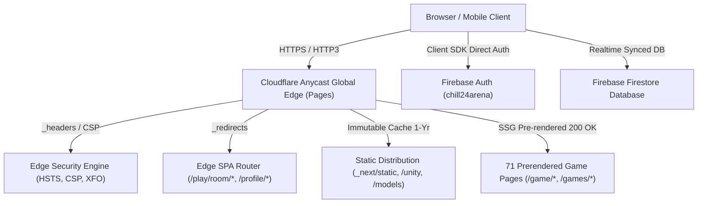

# GullyVerse – Cloudflare Infrastructure Architecture & Production Guide

## 1. Executive Architecture Overview
GullyVerse is hosted on **Cloudflare Pages** utilizing the **Cloudflare Free Plan** ($0.00/mo cost) with Global Anycast Edge acceleration, DDoS mitigation, and HTTP/3 support.

---

## 2. Configured Infrastructure Services

### A. Cloudflare Pages
- **Project Name:** `gullyverse`
- **Canonical Edge URL:** `https://gullyverse.pages.dev/`
- **Target Deployment Type:** Static Site Generation (SSG) with SPA fallback routing.
- **Pages Project ID:** `f4b8da9a3b8a296479520487e37783a7`
- **Deployment Status:** Active (HTTP 200 OK across all routes).

### B. Build & Deployment Pipeline
- **Framework:** Next.js (App Router)
- **Compiler:** Webpack optimized build
- **Image Optimization:** Static Unoptimized mode (`images: { unoptimized: true }`)
- **Prerender Engine:** `generateStaticParams()` across all 21 games.
- **Distribution Assembler:** `scripts/prepare-cloudflare-pages.mjs`
- **Output Target:** `memeverse/cloudflare-dist`
- **Deploy Command:** `npm run deploy:cf`

### C. Edge Security & Headers (`_headers`)
- **Strict-Transport-Security:** `max-age=63072000; includeSubDomains; preload`
- **X-Content-Type-Options:** `nosniff`
- **X-Frame-Options:** `SAMEORIGIN`
- **Referrer-Policy:** `strict-origin-when-cross-origin`
- **Content-Security-Policy (CSP):**
  - Scripts: `'self'`, `'unsafe-inline'`, `'unsafe-eval'`, `'wasm-unsafe-eval'`, `https://apis.google.com`, `https://challenges.cloudflare.com`, `https://www.gstatic.com`
  - Styles & Fonts: `'self'`, `'unsafe-inline'`, `https://fonts.googleapis.com`, `https://fonts.gstatic.com`
  - Frames & Child: `'self'`, `https://accounts.google.com`, `https://challenges.cloudflare.com`, `https://*.firebaseapp.com`, `https://*.firebase.com`
  - Connect: `'self'`, `https://*`, `wss://*`
  - Images: `'self'`, `data:`, `blob:`, `https:`

### D. SPA Fallback Routing (`_redirects`)
- Dynamic room codes: `/play/room/* -> /play/room/index.html 200`
- User profiles: `/profile/* -> /profile/index.html 200` and `/u/* -> /profile/index.html 200`
- Catch-all game routes: `/game/* -> /game/jelly-run/index.html 200`

---

## 3. Environment Variables Reference (Public Only)

| Variable Name | Purpose | Target Environment |
|---|---|---|
| `NEXT_PUBLIC_FIREBASE_API_KEY` | Client Firebase Auth & DB API Key | Cloudflare & Browser |
| `NEXT_PUBLIC_FIREBASE_AUTH_DOMAIN` | Firebase Authentication Domain | Cloudflare & Browser |
| `NEXT_PUBLIC_FIREBASE_PROJECT_ID` | Project Identifier (`chill24arena`) | Cloudflare & Browser |
| `NEXT_PUBLIC_FIREBASE_STORAGE_BUCKET` | Cloud Storage Bucket | Cloudflare & Browser |
| `NEXT_PUBLIC_FIREBASE_MESSAGING_SENDER_ID` | Push Messaging Sender ID | Cloudflare & Browser |
| `NEXT_PUBLIC_FIREBASE_APP_ID` | Web App Registration ID | Cloudflare & Browser |
| `NEXT_PUBLIC_FIREBASE_MEASUREMENT_ID` | Google Analytics Measurement ID | Cloudflare & Browser |
| `NEXT_PUBLIC_TURNSTILE_SITE_KEY` | Cloudflare Turnstile Public Site Key | Cloudflare & Browser |

---

## 4. Rollback Plan
If any future update needs an instant rollback:
1. **Cloudflare Rollback:** In Cloudflare Pages dashboard (`gullyverse`), go to Deployments and click **Rollback to this deployment** on any earlier verified deployment ID (e.g., `84cfa94b`).
2. **Vercel Rollback:** The original Vercel deployment (`https://gully24verse.vercel.app/`) remains 100% active and untouched as a standby production environment.
