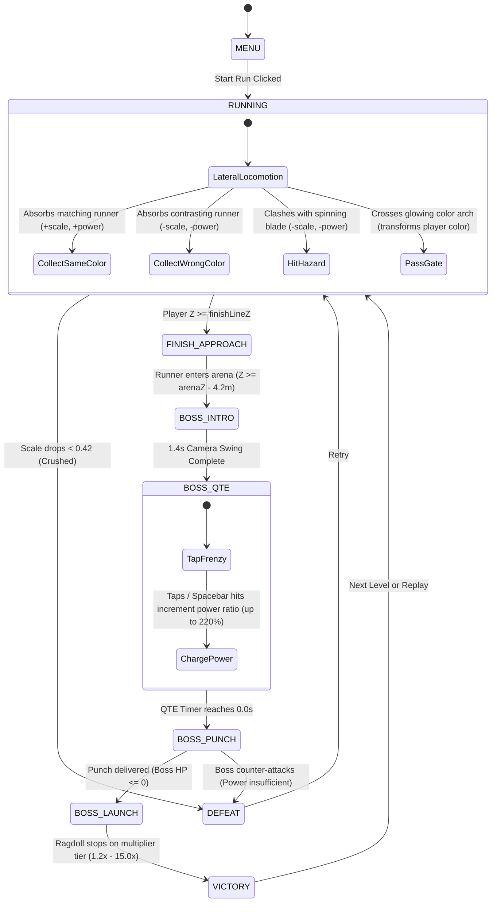

# Giant Rush! — Gameplay Comparison & Root-Cause Audit

This document details the reverse-engineered comparison between the reference title (**Giant Rush!** by Lion Studios / Famobi / PlayCanvas) and the GullyVerse 3D WebGL implementation.

---

## 1. Feature-by-Feature Comparison Matrix

| Gameplay System | Reference Game Behavior | Pre-Audit Implementation | Identified Root Cause | Engineering Fix Applied | Verification Status |
|---|---|---|---|---|---|
| **Keyboard Controls** | Holding A/D or Left/Right provides smooth, responsive, continuous lateral movement with boundary safety. | Jittery, sluggish, and frequently reset player position back to 0. | 1. Browser key events not prevented. 2. React state re-renders clobbered `playerStateRef.current.x` with stale React state. 3. Missing window blur cleanup. | Rewrote lateral controller with velocity-based acceleration interpolation ($V_{\max} = 15.0\text{m/s}$), single-source-of-truth ref tracking, passive window blur resetting, and keydown `preventDefault`. | **VERIFIED & FIXED** |
| **Colour Section Length** | Each color corridor lasts 6 to 10 seconds (80m–120m), allowing the player to spot lane patterns, steer, and chain 8–15 figures. | Track length was 130m total with forward speed 17m/s (whole run finished in 7.6s; gates were only 45m apart). | Arbitrary short track configurations; gates spaced too tightly; no procedural pacing. | Tripled track lengths (Level 1: 360m, Level 2: 460m, Level 3: 560m). Spaced color gates every 90m with dedicated entry zones and lead-in zones. | **VERIFIED & FIXED** |
| **Collectible Generation** | Collectibles form coherent single-color streams (e.g. 5–7 matching runners in a single lane) alternating with hazard/opposing lanes. | Random color picked per row independently across all lanes; no continuous lanes existed. | Unstructured RNG spawning in `CollectiblesManager`. | Built a procedural lane cluster engine: picks matching stream lane for 5–7 rows, populates other lanes with distinct contrasting colors, then switches lanes smoothly. | **VERIFIED & FIXED** |
| **Finish Line & Boss Transition** | Player sprints through the finish line arch, smoothly transitions into the boss arena, halts face-to-face with the Titan boss. | Reaching finish line froze the runner 25m away; player stopped moving forward; screen softlocked at 100%. | 1. React `useEffect` had `[phase]` in dependency array, causing cleanup to cancel animation frame and mark `isMounted = false`. 2. Pending `setTimeout` for QTE aborted silently. 3. Player forward movement stopped at finish line instead of arena center. | Implemented `FINISH_APPROACH` phase in engine loop: player sprints into arena to confrontation distance ($z = \text{arenaZ} - 4.2\text{m}$), centers smoothly, then initiates 1.4s camera swing and QTE. Managed deterministically in 60FPS loop without brittle timeouts. | **VERIFIED & FIXED** |
| **Boss QTE Brawl & Punch** | Rapid tapping / spacebar smashing charges up a massive punch meter before 3.0s timer expires; colossal punch launches boss. | Overlay values (`timeRemaining`, `qteTaps`, `powerRatio`) were static because engine class properties didn't trigger React re-renders; punch did not launch. | React state was not coupled to engine QTE timers; tap count remained visually frozen at 0. | Connected `qteTime`, `qteTaps`, and `qtePowerRatio` to reactive component state; wired both Big Button tap and SPACEBAR / ENTER keypresses; added real-time power gauge animation. | **VERIFIED & FIXED** |
| **Boss Ragdoll Launch** | Defeated boss gets launched along the multiplier runway ($1.2\times$ to $15.0\times$), bouncing with friction until resting at a score tier. | Camera and launch physics were partially implemented but cut off by transition timer issues. | Launch phase had secondary timeouts subject to component teardown. | Integrated `BOSS_LAUNCH` trajectory into engine update loop; dynamic camera smoothly tracks the airborne boss and pans down upon landing. | **VERIFIED & FIXED** |

---

## 2. Finite State Machine (FSM) Architecture

---

## 3. Mathematical Models & Balance Tuning

### Dynamic Scaling
$$\Delta S = \begin{cases} +0.065 \cdot (1 + \text{streak} \cdot 0.05) & \text{if } \text{color} = \text{player.color} \\ -0.090 & \text{if } \text{color} \neq \text{player.color} \\ -0.250 & \text{if obstacle collision} \end{cases}$$

### Scale Clamp
$$S \in [0.42, 3.80]$$

### Punch Damage Calculation
$$\text{Damage} = \text{round}\left( \text{PlayerPower} \cdot \text{PowerRatio} \right)$$
Where:
$$\text{PowerRatio} = \min(2.20, 1.0 + \text{Taps} \cdot 0.08)$$

### Launch Ragdoll Trajectory
$$V_y = 16.0 + 3.5 \cdot \sqrt{\text{Damage} / 20}$$
$$V_z = 24.0 + 6.5 \cdot \sqrt{\text{Damage} / 20}$$
$$\text{Gravity} = 28.0\text{ m/s}^2, \quad \text{Bounce Restitution} = 0.35, \quad \text{Ground Friction} = 0.88$$
